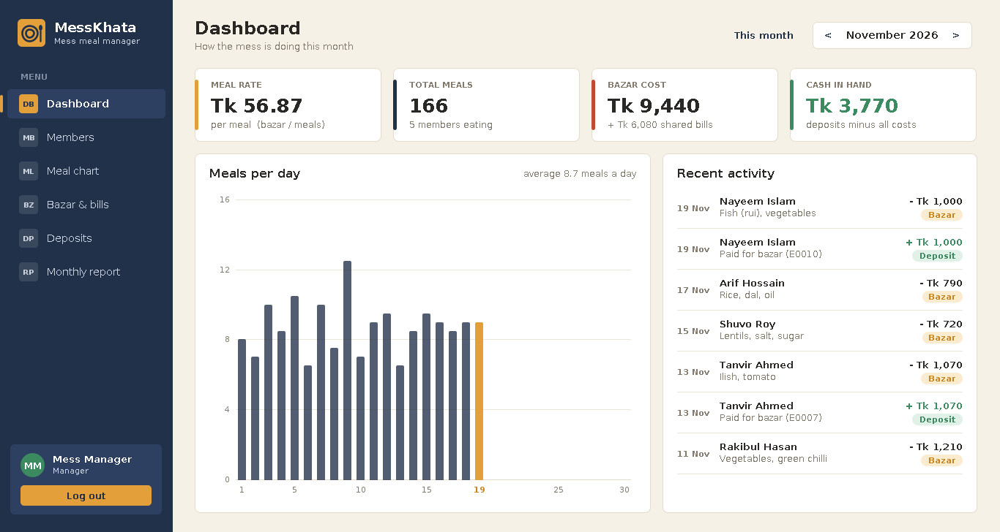
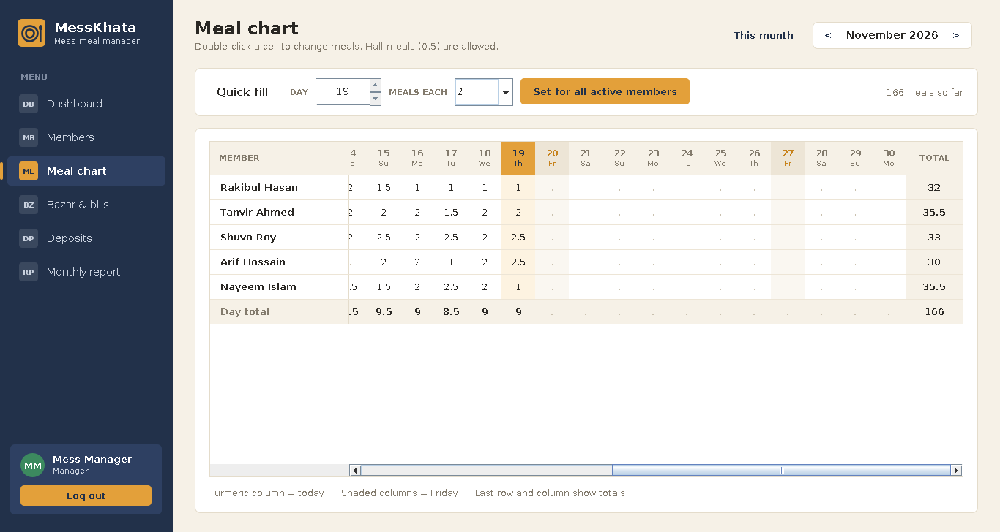
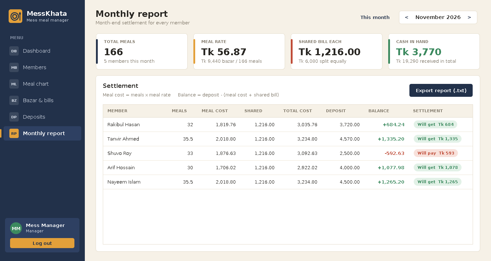
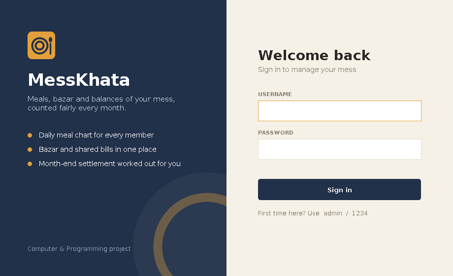

<div align="center">

# MessKhata: Mess Meal Manager

**A Java desktop app that keeps the khata (account book) of a student mess.**
Daily meal chart, bazar and shared bills, deposits, and an automatic month-end settlement.




</div>

## Why this project

In almost every Bangladeshi student mess one person acts as the manager. They count meals on a paper chart,
collect advance money, note every bazar, and at the end of the month sit down with a calculator to find the
meal rate and who owes whom. Mistakes and arguments are common.

MessKhata does that bookkeeping. The manager enters meals, bazar and deposits during the month, and the app
calculates the meal rate and each member's balance instantly.

## Features

- **Login** for the mess manager
- **Dashboard**: meal rate, total meals, bazar cost, cash in hand, a meals-per-day chart and recent activity
- **Members**: add, edit, search, mark someone as left; members with history cannot be deleted by mistake
- **Meal chart**: a member x day grid like the paper chart on the wall, half meals allowed, one-click fill for everyone,
  today and Fridays highlighted
- **Bazar & bills**: bazar is shared by meals eaten, bills such as cook, gas and Wi-Fi are shared equally;
  "paid from own pocket" also credits the member's deposit
- **Deposits**: advance money per member with running totals
- **Monthly report**: who will get money back and who has to pay, exportable as a `.txt` file
- **Any month**: switch to previous or next months from the top bar
- Data is saved automatically in plain text files, so no database setup is needed

## Screenshots

| Meal chart | Monthly report |
|---|---|
|  |  |

| Bazar & bills | Deposits |
|---|---|
|  |  |

| Login | Members |
|---|---|
|  |  |

## Getting started

### Requirements

- **JDK 11 or newer** (check with `java -version`)
- Any one of: **NetBeans**, **IntelliJ IDEA**, or just a terminal

### 1. Clone the repository

```bash
git clone https://github.com/feroz-afm/MessKhata-Mess-Meal-Manager.git
cd MessKhata-Mess-Meal-Manager
```

No Git? Click **Code > Download ZIP** on GitHub and unzip it.

### 2. Run it

**Option A: NetBeans (recommended)**

1. **File > Open Project** and select the cloned folder (it shows a Maven icon).
2. Right-click the project and choose **Run** (or press `F6`).
   The first build needs internet once so Maven can download its build plugins.

**Option B: IntelliJ IDEA**

1. **File > Open** and select the `pom.xml` file, then choose **Open as Project**.
2. Open `src/main/java/com/messkhata/Main.java` and click the green run button.

**Option C: Terminal with Maven**

```bash
mvn package
java -jar target/MessKhata-1.0.jar
```

**Option D: Terminal without Maven (only the JDK)**

Linux / macOS:

```bash
javac -encoding UTF-8 -d out $(find src/main/java -name "*.java")
java -cp out com.messkhata.Main
```

Windows (PowerShell):

```powershell
javac -encoding UTF-8 -d out (Get-ChildItem -Recurse -Filter *.java src\main\java).FullName
java -cp out com.messkhata.Main
```

### 3. Sign in

| Username | Password |
|---|---|
| `admin` | `1234` |

On the first run the app creates a `mess_data/` folder with one month of sample data
(5 members with meals, bazar, bills and deposits) so every screen has something to show.
Delete that folder to start with an empty mess.

## How the money is calculated

```text
Meal rate        = total bazar / total meals
Meal cost        = member's meals x meal rate
Shared bill each = total shared bills / members sharing that month
Balance          = deposit - (meal cost + shared bill each)

Balance > 0  ->  the member will get money back
Balance < 0  ->  the member has to pay
```

**Example:** bazar Tk 1,000 and 10 meals give a meal rate of Tk 100. A member who ate 4 meals, shares a
Tk 600 gas bill with one other member and deposited Tk 1,000 has a balance of
1,000 - (400 + 300) = **+Tk 300** and gets that back.

## Project structure

```text
src/main/java/com/messkhata
├── Main.java                  starts the app
├── model/                     data classes
│   ├── Storable.java          interface: every saved object can turn itself into one line
│   ├── Person.java            abstract: id, name, phone
│   ├── Member.java            extends Person: room, join date, active
│   ├── Manager.java           extends Person: username, password, login check
│   ├── Transaction.java       abstract: id, date, member, amount
│   ├── Deposit.java           extends Transaction: money coming in
│   ├── Expense.java           extends Transaction: money going out
│   ├── ExpenseCategory.java   enum: BAZAR, SHARED
│   ├── MealSheet.java         meals of one month
│   ├── MemberSummary.java     one member's account for a month
│   └── MonthSummary.java      totals and all member accounts
├── data/
│   └── FileDatabase.java      backend storage: one text file per table
├── service/
│   ├── MessService.java       backend logic: rules, validation and calculations
│   ├── MessException.java     custom exception with a readable message
│   └── SampleData.java        demo data for the first run
└── ui/
    ├── theme/Theme.java       colour palette, fonts, table styling
    ├── components/            custom-painted widgets: cards, buttons, sidebar, chart, logo
    ├── LoginFrame.java
    ├── MainFrame.java         sidebar, month switcher, page switching
    └── panels/                one class per page, all extend BasePanel
```

The app follows a simple layered design: the **UI** only talks to **MessService**, MessService applies the rules
and does the maths, and **FileDatabase** reads and writes the files.

## OOP concepts used

| Concept | Where to find it |
|---|---|
| Encapsulation | Private fields with getters and setters in every model class |
| Inheritance | `Member`, `Manager` extend `Person`; `Deposit`, `Expense` extend `Transaction`; every page extends `BasePanel` |
| Abstraction | `Person`, `Transaction` and `BasePanel` are abstract classes |
| Interface | `Storable`, implemented by every class that is saved to a file |
| Polymorphism | The dashboard's recent activity calls `getType()`, `getDescription()` and `isIncome()` on a `List<Transaction>`; each subclass answers in its own way |
| Exception handling | `MessException` for rule violations, `IOException` for file problems |
| Enum and collections | `ExpenseCategory`; `ArrayList`, `HashMap`, `LinkedHashMap` |

## Data files

Everything is stored in `mess_data/` as plain text, one record per line, fields separated by `|`:

| File | Contents |
|---|---|
| `members.txt` | id, name, phone, room, join date, active |
| `managers.txt` | login accounts |
| `deposits.txt` | id, date, member, amount, note |
| `expenses.txt` | id, date, paid by, category, amount, details |
| `meals_YYYY-MM.txt` | one line per member with the meals of each day |
| `report_YYYY-MM.txt` | created when a report is exported |

## Possible improvements

- Change password and multiple manager accounts
- Store data in MySQL or SQLite
- Export the report as PDF
- Bangla language option

## License

Released under the [MIT License](LICENSE).
