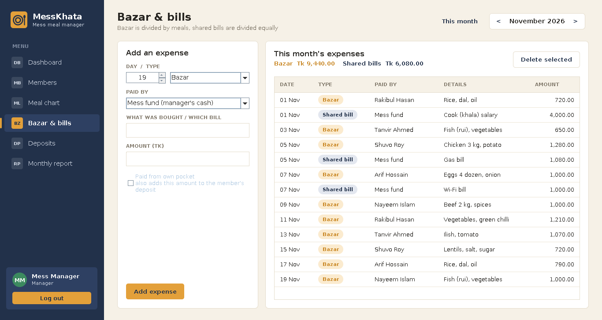
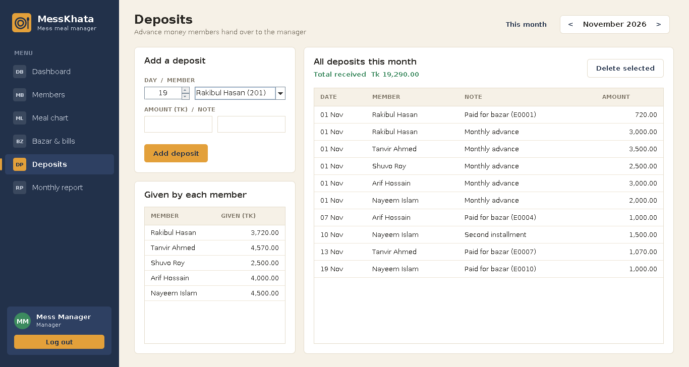
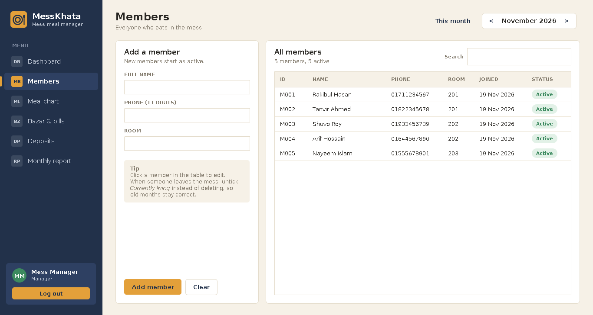

<div align="center">

# MessKhata: Mess Meal Manager

**A Java desktop app that keeps the khata (account book) of a student mess.**
Daily meal chart, bazar and shared bills, deposits, and an automatic month-end settlement.

[](https://github.com/feroz-afm/MessKhata-Mess-Meal-Manager/actions/workflows/build.yml)


</div>

## Contents

[Why](#why-this-project) · [Features](#features) · [Screenshots](#screenshots) · [Quick start](#quick-start) ·
[Run options](#run-options) · [A month in MessKhata](#a-month-in-messkhata) · [Calculations](#how-the-money-is-calculated) ·
[Structure](#project-structure) · [OOP](#oop-concepts-used) · [Data files](#data-files) · [Tests](#tests) ·
[FAQ](#faq) · [Roadmap](#roadmap)

## Why this project

In almost every Bangladeshi student mess one person acts as the manager. They count meals on a paper chart,
collect advance money, note every bazar, and at the end of the month sit down with a calculator to find the
meal rate and who owes whom. Mistakes and arguments are common.

**MessKhata does that bookkeeping.** The manager enters meals, bazar and deposits during the month, and the app
calculates the meal rate and every member's balance instantly.

## Features

| Page | What you can do |
|---|---|
| 🔐 **Login** | Sign in as the mess manager |
| 📊 **Dashboard** | Meal rate, total meals, bazar cost, cash in hand, meals-per-day chart, recent activity |
| 👥 **Members** | Add, edit, search, mark as left; members with history are protected from deletion |
| 🍛 **Meal chart** | Member × day grid like the paper chart, half meals, one-click fill, today and Fridays highlighted |
| 🛒 **Bazar & bills** | Bazar shared by meals eaten; cook, gas, Wi-Fi shared equally; "paid from own pocket" credits a deposit |
| 💰 **Deposits** | Advance money per member with running totals |
| 📄 **Monthly report** | Who gets money back and who has to pay, exportable as `.txt` |
| 📅 **Any month** | Switch to previous or next months from the top bar |

Data is saved automatically in plain text files, so **no database setup** is needed.

## Screenshots

| Meal chart | Monthly report |
|---|---|
|  |  |

| Bazar & bills | Deposits |
|---|---|
|  |  |

| Login | Members |
|---|---|
|  |  |

## Quick start

You only need **JDK 11 or newer** (check with `java -version`).

```bash
git clone https://github.com/feroz-afm/MessKhata-Mess-Meal-Manager.git
cd MessKhata-Mess-Meal-Manager
```

| Windows | Linux / macOS |
|---|---|
| double-click **`run.bat`** | `./run.sh` |

No Git? Click **Code > Download ZIP** on GitHub and unzip it.

## Run options

**NetBeans (recommended):** **File > Open Project**, choose the folder (Maven icon), then **Run** (`F6`).
The first build needs internet once so Maven can download its plugins.

**IntelliJ IDEA:** **File > Open** → `pom.xml` → **Open as Project**, then run `com.messkhata.Main`.

**Maven:**
```bash
mvn package
java -jar target/MessKhata-1.0.jar
```

**JDK only (manual):**
```bash
javac -encoding UTF-8 -d out $(find src/main/java -name "*.java")
java -cp out com.messkhata.Main
```
```powershell
javac -encoding UTF-8 -d out (Get-ChildItem -Recurse -Filter *.java src\main\java).FullName
java -cp out com.messkhata.Main
```

**Ready-made jar:** every push builds `MessKhata-1.0.jar` — download it from the latest
[Build run](https://github.com/feroz-afm/MessKhata-Mess-Meal-Manager/actions/workflows/build.yml) under *Artifacts*.

## Sign in

| Username | Password |
|---|---|
| `admin` | `1234` |

On the first run the app creates a `mess_data/` folder with one month of sample data
(5 members with meals, bazar, bills and deposits) so every screen has something to show.
Delete that folder to start with an empty mess.

## A month in MessKhata

1. **Start of month** — add new members, record everyone's advance in **Deposits**.
2. **Every day** — fill the **Meal chart** (use *fill all* and fix the few who skipped).
3. **After each bazar** — add it in **Bazar & bills**; tick *paid from own pocket* if a member paid.
4. **When a bill comes** — add cook, gas, Wi-Fi as a shared bill.
5. **Month end** — open **Monthly report**, export the `.txt` and share it in the mess group.

## How the money is calculated

```text
Meal rate        = total bazar / total meals
Meal cost        = member's meals x meal rate
Shared bill each = total shared bills / members sharing that month
Balance          = deposit - (meal cost + shared bill each)

Balance > 0  ->  the member will get money back
Balance < 0  ->  the member has to pay
```

### Example

Bazar **Tk 1,000**, **10 meals** → meal rate **Tk 100**. A gas bill of **Tk 600** is shared by 2 members.

| Member | Meals | Meal cost | Shared | Deposit | Balance |
|---|---:|---:|---:|---:|---:|
| Rahim | 4 | 400 | 300 | 1,000 | **+300** (gets back) |
| Karim | 6 | 600 | 300 | 500 | **−400** (has to pay) |

This exact case is checked automatically in the [tests](#tests).
